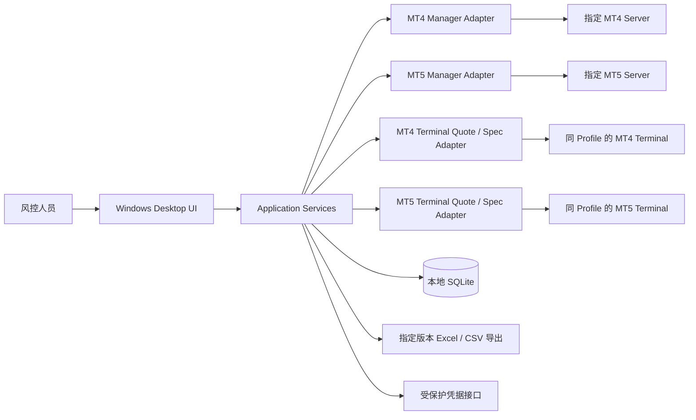

# System Architecture

状态：DRAFT FOR REVIEW。以下模块划分、执行和持久化机制为 **PROPOSED ARCHITECTURE**，不代表已实现。冻结业务见 [01](01-product-scope-and-decisions.md)，计算唯一依据为 [03](03-markout-calculation-spec.md)。

## 1. 推荐形态与系统上下文

采用一个独立 Windows Desktop 应用，进程内模块化分层、本地 SQLite、后台有界工作队列。没有 Web 后端、REST 服务、远程 Agent 或容器。先以一个应用进程为目标；只有实际 SDK 位数/崩溃隔离/调用限制证明必须时，才评审最小本地 SDK worker（Q24），不预建通用服务架构。

MT4 Terminal 历史双边 Tick 是未通过的能力门槛（Q01），图中接口不表示其已有可用实现。不同平台/Profile 的连接与数据流不可串接。其他 mt-plugins 项目、Terminal 安装目录和 SDK 源码不是本应用写入区。

## 2. 模块职责与禁止越界

| 模块 | 输入 → 输出 / 责任 | 不负责 |
|---|---|---|
| Desktop Presentation | 页面状态、操作命令、只读结果投影、焦点/下钻恢复 | 计算公式、直接持有 SDK 对象 |
| Task Application Service | 创建任务/版本、队列、预检、阶段、取消、保存发布 | 决定缺失业务规则或并行线程数给用户 |
| Profile Service | Platform+ProfileId+配置修订、Expected Server、credential reference | 将密码写入配置快照 |
| MT4/MT5 Manager Adapter | 验证账户、读取真实记录、原始字段快照、分页/覆盖证据 | 用 Manager Tick 替代 Terminal 报价，修改交易 |
| Normalization | 映射 Side/Entry/Volume/Source IDs/TimePrecision，筛选事件范围 | 重建持仓生命周期、合并 MT5 Deal、修复缺失 TimeMsc |
| Terminal Quote Provider | 精确 Symbol、规范时间请求、按块取 Tick+完成度+来源 | 决定 Markout/把超时转换为 NO_QUOTE |
| Terminal Spec Provider | Terminal Spec、币种/模式/Point、来源和捕获时点 | 悄悄以 Manager Spec 或当前别的账户条件替代 |
| Quote Matcher | 按已确认有效性及并列规则，选最新有效 Tick≤Target，给出选择证据 | 拉行情、插值、设 stale 阈值、模糊 Symbol |
| Markout Calculation Core | 标准事件+规则+匹配结果+Spec → Price/Points/Mid Price、窗口结果、事件完整性 | SDK 类型、UI、真实利润/费用、账户风险标签 |
| Money Calculator Boundary | 同平台的受支持原生计算器或已验证模式公式 → Money/方法/输入/状态 | 通用乘法兜底、隐含接受 FX、用 Raw Profit 填补 |
| Summary Projection | 单版本单 Login 的统一有效集合 → 各窗汇总/Ranking | 合并 Login、按窗重新挑部分完整 Event |
| Persistence & History Query | 版本拥有的快照/结果/诊断，离线读取，事务发布 | 读取历史时自动重连或重算 |
| Diagnostics & Technical Log | 分层问题、完整计算链、脱敏 Copy | 主界面堆 Trace、User Audit Logs、隐藏窗口多原因 |
| Export | 一个明确 Version 的稳定快照 → XLSX/CSV ZIP | 默认偷偷导出 latest、改写版本数据 |

这里只定义模块责任，未要求每模块建单独程序集或进程；依赖/项目数量留给 Implementation Design。

## 3. 统一数据流

### MT5

绑定 Profile 修订 → 环境预检 → Accounts 去重/验证 → Manager 获取真实 Deal 候选 → 保留原始字段与查询证据 → Action 仅 BUY/SELL → TimeMsc 校验/范围判断 → 保留 IN/OUT/INOUT/OUT_BY 原 Entry 与实际 Side → 精确 Symbol Terminal Spec → Tick 获取/完整性证明 → 九窗匹配 → Price/Points/Mid Price/Money → 全窗完整性 → 单账户 Summary → 原子发布版本。

Manager 页接口的范围可能以秒表示；适配层须取覆盖目标范围的候选，再以实际 TimeMsc 精筛。端点规则 Q06，缺失 TimeMsc 的范围归属 Q12，分页稳定性 Q24 均不能静默推断。

### MT4

同平台/Profile 预检 → 账户与订单候选覆盖 → 对真实 BUY/SELL 订单独立检查 OpenTime、CloseTime → 每个在范围内的事件映射实际 Side → SECOND 时间保留、计算表示补 .000 → 仅七个支持窗 → 同一匹配、计算、完整性与汇总路径。

获取“范围内开仓但范围后才平仓/仍未平仓”的覆盖策略必须验证，不能假定 TradesUserHistory 即全部覆盖；部分平仓的真实 Volume 和事件身份见 Q10，不通过持仓重建修补。

### NormalizedTradeEvent 契约

Platform、ProfileId、ProfileRevision、VersionId 或 TestSessionId、Login、SourceId、OrderId、PositionId（可空）、EventType（MT5 DEAL/MT4 OPEN/CLOSE）、EntryType、完整 Symbol、Side、VolumeLots、Price、EventTime、TimePrecision、RawRecordRef、时间语义/原始单位说明。

- ID 不以浮点数存储或展示；Event Identity 含平台/Profile/Login/Source/EventType，MT4 部分平仓身份待 Q10。
- 原始值与规范值并存，不丢原始 volume 编码。MT5 Volume/VolumeExt 不能混用单位。
- 不合法的候选可保存为诊断记录；不能靠填默认时间使其成为引擎可执行事件。
- 平台差异集中于 Adapter/Normalization 和由规则传入的窗口能力，计算器不遍布 MT4/MT5 分支。

## 4. Quote Retrieval 与 Matching

推荐分开。Quote Provider 负责“拿到什么、来自哪里、是否完整”；Matcher 负责“为什么选这一条”。

**请求契约**：Platform+ProfileRevision+Server identity+Terminal binding+完整 Symbol+时间基准+目标范围。必要时加入已验证的报价可见性/group 上下文，不能假定账户不同但报价条件必相同。

**响应契约**：规范化 Tick 时间/Bid/Ask/flags/来源顺序；已覆盖区间；是否完整；同步/权限/连接错误；可用历史边界（若可证明）。这是技术建议，不是对现有接口能力的宣称。

1. 分块、单调推进、保留块边界，处理 inclusive 接口的重复返回，但不能仅按时间戳去重而丢同毫秒多 Tick。
2. 获取首个 Target 之前所需 predecessor；Quote 可早于 Event。有限 lookback 未找到 ≠ 已证明 NO_QUOTE。覆盖不足走环境/能力诊断（Q07）。
3. 最后请求需涵盖最晚 Event+180s，不能按任务 To 截断。Target 尚未可观测的处理见 Q22。
4. 所有支持窗要求双边价；flags 不代表 Bid/Ask 本身有效（Q04/Q05）。
5. 缓存仅在 Platform/Profile 修订/Server/Symbol/时间语义及已确认共享条件一致时复用；账户结果永远隔离。未完成响应不能命中“完整”缓存。
6. 有界内存缓存随任务/块释放；SQLite 保存实际匹配报价、必要的失败候选诊断和覆盖证据，不建全流 Tick 库。Terminal 自有缓存副作用单列 Q23。

## 5. Money 的独立边界

Price/Points 在固定输入下可确定计算。整个 Money 路径不能在尚使用当前环境原生 API 时宣称“纯函数、历史环境可完全重放”。

调用顺序：确认 USD 分析范围和上下文 → 检查同平台 Terminal/SDK 原生计算器是否满足已确认规则 → 若不适用，仅用已验证的 CalcMode+完整 Spec 公式 → 若仍不支持，保留诊断并按 Q09 待定资格处理，不制造零值。

Native 输入必须使用事件的实际 Side、真实成交量、EventPrice，以及 BUY 的 FutureBid / SELL 的 FutureAsk。记录具体方法/API build、group/account currency、Profit Currency、Spec 快照、输入/输出及可得 rate；但记录了当前 rate 并不等于用户已准许 Currency Conversion。

Q03 未结前，不能将“SDK 优先”解释成允许当前汇率转换。Q13 决定 Spec 时点及 Terminal 与被分析账户条件不一致的处置。原生黑盒可保存原始输出供核查；能否离线独立重算要逐方法证明，不冒充历史行情/合约环境重建。

## 6. Task Execution、进度、取消与重试

**PROPOSED**：V1 内部默认一个任务执行器；各 Manager/Terminal 会话串行拥有 SDK 对象，UI 线程不做阻塞请求。先保证确定的结果与取消，再凭测量考虑安全并行；不向用户暴露线程控制。

阶段：Preflight → Validate Accounts / Fetch History → Load Spec → Fetch Ticks → Calculate → Save / Publish。显示阶段及已处理账户/事件数；总数未确定时显示“正在读取”，不虚构百分比或 ETA。分阶段总数变化不能倒退成不明含义的进度。

- 账户不存在：保留跳过记录，继续其他有效账户。环境/持续连接失败：Task FAILED，不能把受影响事件全部贴 NO_QUOTE。
- 重试仅瞬态只读操作，有上限、可取消、记录尝试；建议最多两次短退避，数值留待 SDK 超时/限频验证。身份/服务器不匹配不自动换配置或重试到其他 Profile。
- Cancel 在块边界和 API 返回后检查；具体 SDK 可否及时中断待 Q24。不可安全强制终止未知 native 调用，也不能提前显示“已取消”。
- 计算期间可保存未发布批次以支持诊断；完成全部范围且通过资格/一致性检查后才发布正式 Summary。
- Cancel 与最终提交竞争由本地事务裁决：建议提交前接受取消则 CANCELLED；已成功发布后说明已完成，不改成部分取消。内部 Cancelling/Committing 仅阶段，不新增任务业务状态。
- FAILED/CANCELLED 仍有任务、版本和诊断，不显示正式部分 Summary；全无效/空/全丢弃任务终态待 Q14。

## 7. History 与 Re-analyze

History Service 只读 SQLite 快照，不需要可用 Profile、Terminal、Manager。显示当前所选版本的 Snapshot 名称及范围，不能拿当前 Profile 名称覆盖历史含义。

新运行总是分配新 Version，旧版不可覆盖。建议同一 Task 同时只允许一个活动 Version；Task 的 History 状态明确代表最新版本状态，另可显式打开旧已完成版，不能把失败最新版本伪装成成功。

Re-analyze 默认原范围/账户/平台/Profile；配置已改/缺失时必须显式提示，行为由 Q15/Q18 决定。没有隐式 Profile 替换。V1 只浏览版本，不实现 Diff/Tolerance。

重启：已提交完成、失败、取消仍可读；原 RUNNING 不得自动变 COMPLETED。提议 INTERRUPTED 或 FAILED+interrupted reason 两种方案留 Q19；不实际增加新状态，不实现 Pause/Resume。PENDING 自动开跑与否也须 Review。

## 8. Persistence、Export、Diagnostics

逻辑模型见 [04](04-data-model.md)，状态见 [05](05-state-and-error-model.md)。建议一个本地数据库写入协调者、短批次事务、完成发布事务、界面分页读取；不在网络请求期间保持长数据库事务。磁盘满/写失败不得报完成；已有已发布版本仍应保持一致。

Export 绑定显式 VersionId 和只读快照。XLSX 一个版本、TaskSummary 与每 Login 三表；CSV 多账户 ZIP 每 Login 三文件。保存所有窗口与证据，尤其 Discarded 的失败窗，不按当前 UI 可见列裁剪。建议事件一行、每窗字段组，Summary 包含该账户与 Symbol 汇总；具体平铺/字段顺序、命名去重、极限行数处理留 Q21/Implementation Design。不能静默截断数据或拆出未确认的新业务格式。

导出先写明确输出目录内的临时文件，成功后发布，失败清理未完成产物且不改 Version。以上是建议，当前未创建 exports 目录或产物。Copy Diagnostic/计算 Trace 从版本化证据生成，不把 SDK 全对象直接序列化。

## 9. Security、路径与性能

- 本轮仅 docs。未来源码、数据、日志、测试和导出均进入 MarkoutAnalyzer 指定目录；Windows 发布版的数据目录必须明确配置并在后续评审，不写其他插件或 Terminal/SDK 目录。
- Profile 只持有 credential reference；评估 Windows/经确认 SDK 保护方案（Q20）。每次只在必要连接边界短暂取用，不进入 SQLite、Snapshot、Export、Copy、日志、错误文本或应用 Crash Report。
- 不生成含完整进程内存的应用崩溃附件；系统级 dump 策略和第三方 SDK 日志行为需验证，不能承诺未知 SDK 永不泄密。
- 仅读取必要账户/交易/规格/报价；不设计交易下单、资金或服务器配置修改路径。
- 事件流式分页、Tick 块缓存、九/七窗每事件计算；查询 UI 数据按需加载，结果大小与事件数/窗数成比例，不能因“不限日期”一次装满内存。
- 低密度业务能力不为未来云/多用户搭服务。实际规模、磁盘预算、响应目标见 A12；本轮不声称性能测试通过。

## 10. 进入实现前的 Gate

先解决 Q01/Q02/Q03/Q04–Q13 的可计算性与资格；验证 Q23/Q24 的真实连接限制；用户批准状态、版本、删除、导出等行为后，再 Stack Review。SDK/Terminal 未验证不影响本套文档供审阅，但阻止宣称可交付双平台计算实现。

