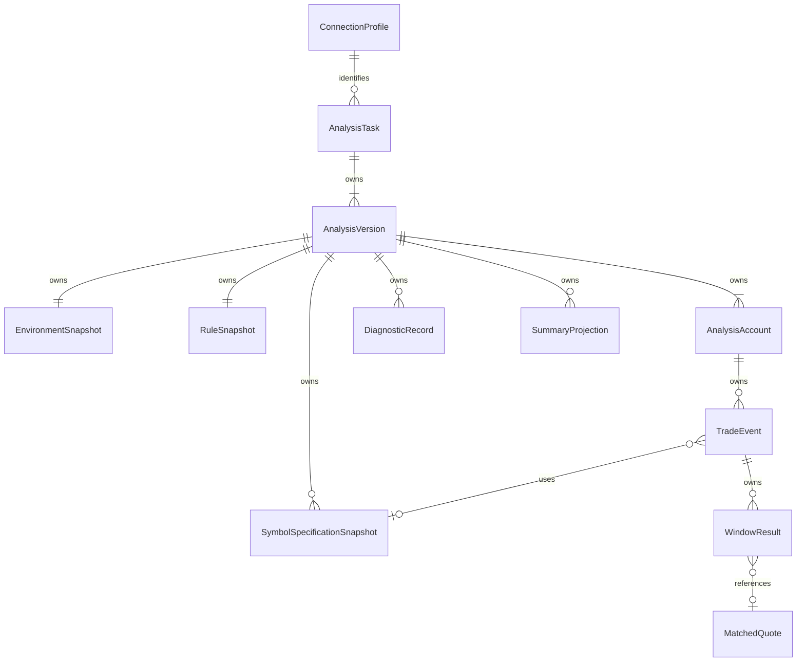

# Logical Data Model

状态：DRAFT FOR REVIEW；**PROPOSED LOGICAL MODEL**。本文件不含 SQL、DDL、迁移或建库操作。冻结数据要求见 D20–D23、D29–D41、D46；公式见 [03](03-markout-calculation-spec.md)。

## 1. 所有权与隔离

图示连接 Profile 是逻辑身份引用，不要求一个存活的可连接 Profile 才能读历史。版本拥有不可变的环境/配置身份快照；删除或改名当前 Profile 不得破坏历史（Q18）。MatchedQuote 可以在一个版本中被多个 WindowResult 引用；跨 Login 复用报价不允许跨 Login 混合结果。

所有正式结果从 VersionId 开始限定范围，不允许仅按 Login/DealID 取“最新记录”。同一 Login、Symbol 或 Ticket 在不同服务器可能重号，身份必须含 Platform/Profile 和来源上下文。

## 2. 核心实体与逻辑字段

| 实体 | 主要字段 | 约束 / 生命周期 |
|---|---|---|
| ConnectionProfile | ProfileId、DisplayName、Platform、Manager Server、Terminal Binding、Expected Terminal Server、ConfigRevision、CredentialReference、可用性 | 秘密不在实体内；稳定 ID 与可变名称分离；运行时修订锁定建议见 Q15/Q18 |
| AnalysisTask | TaskId、Platform、ProfileId、原 Accounts、Server From/To、Remark、CreatedAt、LatestVersionId | 一个任务不跨平台/Profile；账户列表去重但保留无效输入的反馈；CreatedAt 时钟语义不能冒充 Event Server Time |
| AnalysisVersion | VersionId、TaskId、VersionNo、AnalysisAt、VersionRemark、状态、执行阶段、输入快照、Environment/Rule Ref、发布标记、失败/取消信息 | VersionNo 单任务递增、唯一；V2 不改 V1；LatestVersion 可为失败版，不能隐式指向成功版 |
| AnalysisAccount | VersionId、Login、输入顺序、验证状态/原因、已知 Account Currency/Group、处理状态、范围读取完成度、Total/Analyzed/Discarded Counts | 无效账户单独保留；统计未知时为未知而非 0；不与 AccountNotFound 混用非USD/权限错误 |
| TradeEvent | EventId、VersionId/Login、Platform/ProfileRef、SourceId、OrderId、PositionId、EventType、EntryType、Symbol、Side、VolumeLots、Price、EventTime、TimePrecision、RawRecordRef、SpecRef、完整性/资格、丢弃原因 | MT5 Deal 不按 Order 合并；MT4 OPEN/CLOSE 区分身份；无效 TimeMsc 的候选时间可空，只保留诊断，不进入匹配；Q10/Q12 |
| RawTradeRecord | 原始字段和值/单位、SDK/源类型、读取来源、原始记录标识 | 保存下方最小字段；不完整序列化 SDK 对象，不保存任何认证结构 |
| WindowResult | EventId、WindowMs、TargetTime、QuoteMatchState、MatchedQuoteRef、QuoteAgeMs、MainPrice、Points、MoneyUSD、MidPriceMarkout、MoneyMethodRef、CalculationState、ReasonRefs | 每 Event+支持窗最多一个结果；缺失数值为未获得，不能 0 填充；同一 Event 资格跨窗一致 |
| MatchedQuote | QuoteId、VersionId、Platform/ProfileRevision/Server、Symbol、QuoteTime、Bid、Ask、Mid、源精度/原始时间、来源顺序或证据 | 仅实际采用 Tick；不可按时间 alone 合并不同报价；缓存不是此实体 |
| SymbolSpecificationSnapshot | SnapshotId、VersionId、Symbol、Platform/ProfileRevision、来源Terminal、捕获时点、适用账户/group上下文、Digits、Point、ContractSize、TickSize、TickValue及可得方向差异、ProfitCurrency、CalcMode、模式必需字段 | 同版本同 Symbol 若条件不同须有不同快照；不是“全局当前Symbol表”；Point 不由 Digits猜；历史规格可用性待 Q13 |
| MoneyCalculationEvidence | WindowResultRef、方法/版本、输入Side/量/价、单位、group/currency、SpecRef、返回状态/值、可得转换参数、复算限制 | 原生输出和输入供核查；不能因存了rate就视为允许FX；不额外新增MidMoney |
| RuleSnapshot | RuleVersion、固定窗、平台精度规则、公式/方向描述、匹配/有效性/资格规则、Money路径定义、应用build | 用户不能编辑；必须保留可解释规则描述，不能只有不可追踪版本号；Q未结不能伪造冻结版本 |
| EnvironmentSnapshot | Platform、ProfileId与分析时名称/修订、Manager Server、Terminal Server/Binding非秘密标识、Analysis Time、Server Time Context、App/SDK/Terminal版本（可得）、规格来源信息 | 绝不存密码/凭据句柄内容；不可得版本明确 Unknown，不伪造；当前Profile改变不能覆盖 |
| DiagnosticRecord | DiagnosticId、VersionId/TestSessionId、Layer、Stage、Code、受影响Account/Event/Window、时间、简短原因、脱敏技术细节、覆盖/候选证据Ref、RetryAttempt | 四层问题；保留多原因；Environment错误独立，不制造 Window NO_QUOTE |
| SummaryProjection | VersionId、Login、可选Symbol、已确认筛选维度、WindowMs、N、EventVolume、AvgPoints、VWAvgPoints、TotalMoney、AvgMoney、Counts | 可存储为读模型或按结果算；不是额外业务事实；Account不建跨Symbol核心Points；无跨Login总计 |

**技术建议**：Task 状态在 History 中从 LatestVersion 解释，Version 状态为持久化事实；不要在两个地方无规则地维护冲突状态。每 Task 同时一个活动版本为提案。Task/Version Remark 的编辑是否允许及留存方式不在此悄悄加入新功能；先满足创建时备注与版本显示。

## 3. Raw Record 最小映射（§81）

| MT5 | MT4 |
|---|---|
| Login、DealId、OrderId、PositionId、Symbol、Type、Entry、Volume/VolumeExt及原始单位、Price、Time、TimeMsc、Profit、Commission、Swap、Comment、Magic、Reason（接口可得） | Login、Ticket、Symbol、Type、Lots对应原始volume及映射、OpenTime/OpenPrice、CloseTime/ClosePrice、Profit、Commission、Swap、Comment、Magic、可得成交来源信息 |

原始 Time 可为诊断保留，但不能成为 MT5 TimeMsc 的计算回退。原始 Profit/Commission/Swap 不是 Markout Money。Reason/Comment/Magic 不参与成交排除。源字段不存在时保存可得性，不生成想象值。

## 4. 状态、缺失和资格

具体状态见 [05](05-state-and-error-model.md)。建议分别表达 Quote 完整性与 Calculation 成功，避免把“九窗有报价”直接当“金额已可用”。最终聚合资格只可按获批规则生成；Q09 尚未关闭，不预先发布只有 Points 的正式 Summary。

MT4 正式支持窗为七个；100/500ms 的 UNSUPPORTED_TIME_PRECISION 来自平台能力矩阵，可以在 Diagnostics/Test 解释，不算缺窗、不强制生成两个失败结果行。

无效 TimeMsc 可保留 RawRecord + 诊断候选 Event，但 Engine 输入必须有有效规范化时间；范围归属、Total 计数待 Q12。未读到某账户全部历史时，Total 未知；不得把已处理批次数当最终总体。

## 5. 逻辑唯一性、检索与索引意图

**PROPOSED**，只描述访问需要，未来依据数据量和查询计划决定实际索引：

- TaskId；TaskId+VersionNo；VersionId+Login；VersionId+Login+来源事件身份；EventId+WindowMs。
- History 按创建时间、Platform/Profile/状态分页；TaskId/Login 精确检索；Remark 检索方案后续验证，不预建搜索服务器。
- Deal Grid 按 VersionId/Login/Symbol/Side/Entry/Status+EventTime 获取；按选定 Window 的 Points/Money 排序须包含稳定 EventId tie-break。
- Symbol Ranking 按版本/账户/筛选/Window读取，默认 TotalMoney DESC；大表排序由数据访问层处理完整集合，不能只排序屏幕一页。
- Diagnostics 按版本、Layer、Code、Login/Event/Window检索；Reason count 分别按 distinct Event 或 Window，标明粒度。
- Quote 共享去重必须包含来源上下文与完整值/稳定顺序证据，不只使用毫秒时间。Spec 区分上下文和快照时点。

所有查询先约束 VersionId、Login，防止相同 ID 不同服务器串数据。持久化的 64bit ID 需无损表示；数值类型/舍入在 Q25及后续物理设计确定，不能存显示字符串当唯一计算真值。

## 6. 事务、发布与写失败

1. 创建 Task/Version、输入快照和 PENDING 可在短事务完成；运行前固定所用规则/环境身份。
2. 网络读取不持有长数据库写事务。按批保存不可见于正式 Summary 的工作结果、原始记录和诊断；工作批次只是内部发布阶段，不新增用户任务状态。
3. 发布前核对已请求账户/历史覆盖/事件资格/窗口数量/汇总一致性。完成发布以事务同时写最终状态、Summary及发布标记；避免“COMPLETED但结果没存完”。
4. 写失败/磁盘满不发布部分 Summary；保留能够可靠持久化的错误证据。若 SQLite 本身不可写，只能提示和使用获准的脱敏 Technical Log，不能承诺失败诊断必然入库。
5. Cancel 与发布使用同一协调机制裁决；旧版本不可变。未发布数据保留供诊断，不冒充完整分析。是否可导出见 Q17。
6. 重启不能仅因存在结果行就认定完整；以已提交发布标记及状态为准。RUNNING 遗留见 Q19；无断点续算或 Resume。

## 7. 删除、保留与复核

确认删除整个 Task 后，事务删除其所有 Version，以及版本拥有的账户、Raw/Event、WindowResult、MatchedQuote、Money证据、Spec/Rule/Environment快照、Summary及DiagnosticRecord。版本内共享对象随整个 Task 删除；不得删其他任务共享配置或受保护凭据，不单独删一个版本。

Profile 的删除/归档、运行中 Task 的删除、已手动导出文件/独立 Technical Logs 的处理界限见 Q18。建议 Profile 被历史引用时保留身份墓碑/禁用连接，快照继续可读；这是提案，不擅自更改删除业务规则。用户手动导出的文件不应随数据库删除而静默删除。

默认永久保留，没有自动 retention/后台清库。SQLite 存储体积预计主要为 Event×7/9 结果及必要证据；无全量 Tick 流。快照复核包含原始事件、实际匹配行情、完整规则与规格、环境和输出；保存黑盒输出不能替代缺失的历史环境证明。

## 8. Single Trade Test 边界

建议独立 TestSession 和内存结果对象复用同一 Event/Window/Trace 形状，但不引用正式 Task/Version、不进入 History 或 Summary SQL 范围。是否长期保存测试会话、允许何种导出见 Q17；当前不设计测试历史库。Copy Diagnostic 可从当前会话生成并标记 TEST，不伪造正式 VersionId。
