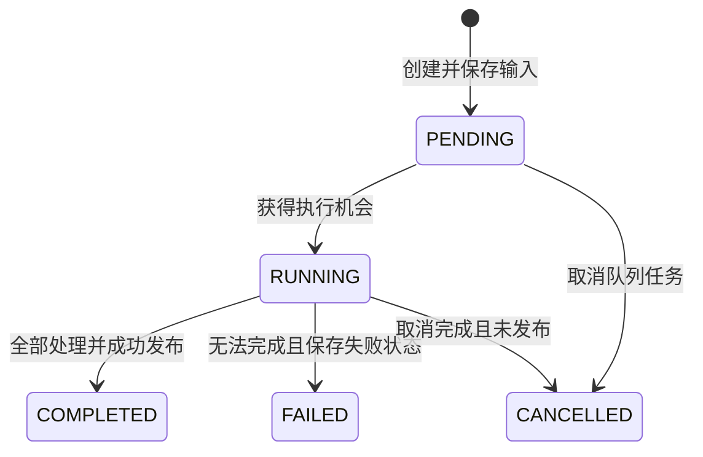

# State & Error Model

状态：DRAFT FOR REVIEW。本文件区分已确认业务状态和 **PROPOSED TECHNICAL / UX** 状态。错误代码是原因，不能直接替代任务状态。冻结规则见 D03、D09–D15、D29、D33–D36。

## 1. Task / Version

已确认：PENDING、RUNNING、COMPLETED、FAILED、CANCELLED。无 Pause/Resume。建议每 Version 拥有执行状态，History Task 行明确显示最新版本状态，旧版状态不变。

“全部处理”不等于所有 Event 必须有效。部分账户 ACCOUNT_NOT_FOUND 不阻塞有效账户；部分 Event 丢弃按已确认规则不参与 Summary。全账户无效、无 Event、全部丢弃时用何终态，必须先决定 Q14，不能由此图私自推导。

| 状态 | 用户可见事实与动作 | 正式结果资格 |
|---|---|---|
| PENDING | 队列中；可 Cancel；无伪进度 | 无 |
| RUNNING | 阶段、已处理/已知总数；可请求 Cancel；可查看已产生诊断 | 未发布工作数据不得成为正式 Summary |
| COMPLETED | 已成功保存可读取版本；可下钻、显式 Export、Re-analyze | 按统一 VALID 集合；不能输出风险结论 |
| FAILED | 简短原因、失败阶段、诊断；修复后 Re-analyze 新版 | 不发布本次部分 Summary；旧完成版本仍可打开 |
| CANCELLED | 明确不完整、取消时阶段/计数/诊断；可重新分析为新版 | 本次部分结果不作正式 Summary |

**PROPOSED 内部阶段**：Preflight、Validate Accounts、Fetch History、Load Spec、Fetch Ticks、Calculate、Save/Publish。Cancelling、Retrying、Committing 只能作为进行中的技术阶段，不新增 Task 业务状态。取消请求不等于已经停止；不支持及时中断的 SDK 调用须显示“等待当前读取结束”（Q24）。

**PROPOSED 提交竞争**：取消在发布事务前生效则 CANCELLED；已发布完成则保持 COMPLETED，提示已完成。禁止同时出现“取消成功”和正式完成同一新版的矛盾反馈。

## 2. Account / Event / Window / Connection

以下过程名称为 **PROPOSED TECHNICAL**，用于分离读取、资格与诊断，不自动新增业务结论。

| 层 | 状态/维度提案 | 已确认结果与约束 |
|---|---|---|
| Account | Waiting / Validating / Processing / Processed / Skipped；Coverage Known/Unknown | ACCOUNT_NOT_FOUND 是明确跳过原因，继续其他账户；非USD Q08、其他账户读取失败 Q24，不随意统称不存在 |
| Event | Pending / Processing；最终 VALID / DISCARDED；QuoteCompleteness 与 CalculationState 分开 | 支持窗出现 NO_QUOTE/INVALID_QUOTE 则整 Event DISCARDED；INVALID_DEAL_TIME_MSC、SYMBOL_NOT_FOUND独立原因；Money等资格 Q09 |
| Window | Pending / Matched / Failed；匹配结果与计算结果分开 | NO_QUOTE/INVALID_QUOTE为窗口原因；成功有 Target/Quote/Age/双边价；缺值不等于0 |
| Platform capability | Supported / UNSUPPORTED_TIME_PRECISION | MT4 100/500ms 不进完整性分母；不是 WindowFailure，也不统计成 discard |
| Connection | Unchecked / Checking / Ready / Unavailable；Retrying 为过程 | 以 Manager/Terminal/Server/QuoteAccess 独立检查项解释，Profile不能只有一个含糊绿灯 |

VALID 不应只表示“有一窗能算”；所有支持窗报价必须完整。尚未决定的 Money/Spec/异常数字分支保留为未决，不借上表擅自改成 VALID 或 DISCARDED。

## 3. 四层错误与确定性恢复

| Layer | Code / 情形 | 影响范围 | 用户反馈 / 恢复 |
|---|---|---|---|
| TaskFailure | MANAGER_CONNECTION_FAILED | 无法读取真实记录；预检不通过或运行中持续失败 | 检查Profile连接，Test Connection/Reconnect；修复后新版本 |
| TaskFailure | TERMINAL_NOT_RUNNING | 绑定Terminal未运行 | 显示所选Profile绑定，用户启动正确Terminal后重新检查；不擅自启动/安装 |
| TaskFailure | TERMINAL_NOT_CONNECTED | 进程存在但连接不可用 | 明确连接项失败；有限重试，不能判NO_QUOTE |
| TaskFailure | SERVER_MISMATCH | Manager/Terminal/Expected Server 不一致 | 列出非秘密实际与预期身份；阻止计算；不猜相近服务器 |
| TaskFailure | QUOTE_ACCESS_FAILED | 无权、同步未完成、部分返回不能证明覆盖等 | 显示具体阶段和可用SDK原因；技术子原因可扩展但须标为PROPOSED |
| AccountSkip | ACCOUNT_NOT_FOUND | 该Login；其它有效Login继续 | 保留输入和原因，可在结果/诊断定位；不要求用户重贴全部账户 |
| EventDiscard | INVALID_DEAL_TIME_MSC | MT5候选记录 | 无Time回退；范围归属及Total见Q12 |
| EventDiscard | SYMBOL_NOT_FOUND | 精确Symbol下的受影响Event | 展示完整带后缀Symbol和Profile；不映射其它Symbol |
| EventDiscard | INCOMPLETE_QUOTES | 任一支持窗口NO_QUOTE/INVALID_QUOTE | 展开全部失败窗及其具体原因，整Event不进任何窗Summary |
| WindowFailure | NO_QUOTE | 成功完成获批历史覆盖后，TickTime≤Target 无Tick；有Tick但无效的分类依Q04/Q05，不以NO_QUOTE代替 | 展示Target、已证实覆盖边界、最后可得候选（若存在）、明确“未匹配” |
| WindowFailure | INVALID_QUOTE | 已获报价未满足获批有效性规则 | 展示失败字段与候选证据；回溯语义依Q04 |
| Technical failure | SQLite写失败/磁盘不足 | 当前版本不能完成发布 | 保留输入/旧版本；说明未保存成功，提供技术诊断，不能把应用报错变成EventDiscard |
| Action failure | Export失败/文件被占用/空间不足 | 本次导出动作 | 版本不变，选目录/关闭占用后重试；不把已完成Task改成FAILED |

表中五个环境代码与业务 discard 代码由需求给定。数据库、覆盖不足、精度/计算失败等更细代码是后续技术设计，不伪称已冻结新业务原因。规范的主因可供排序，但必须保留多个窗口/原因；不能只存一个覆盖全部问题的字符串。

## 4. 统计粒度

- Task/Account：Total、Analyzed、Discarded；读取未完成时不要标最终完整计数。
- Event：同一 Event 多窗口失败只计一次 Discarded；Reason 分类可重叠，必须标注“按事件去重，各原因可能重叠”。
- Window：按失败窗口计数，不与 Event 数相加；不把 MT4 Unsupported 算成失败窗。
- ACCOUNT_NOT_FOUND 是账户数，不冒充丢弃交易数；Task环境失败不是几千笔NO_QUOTE。
- Analysis Rate 的分母、空集、过滤后口径见 Q11；不能自动显示100%/0%或信誉等级。

## 5. 关键页面状态契约

| 情形 | 主界面内容 | 恢复 / 证据 |
|---|---|---|
| 初次空历史 | 尚无任务与 New Analysis入口 | 不显示空坐标当结果 |
| 读取中 | 表结构稳定、Loading或阶段提示 | 不先显示0再跳真值；不阻塞导航 |
| 筛选无匹配 | 当前筛选条件、Clear filters | 区分“没有成交”和“读取失败” |
| 部分无效账户 | 无效Login+原因；有效账户继续 | 链接账户诊断，非模态全阻塞 |
| 无有效事件/全部丢弃 | 明确没有可聚合事件、计数/诊断入口 | 不画零曲线；最终任务状态Q14、空指标Q11待定 |
| 连接失败 | 哪个Profile/哪个检查失败、下一步动作 | 无StackTrace；Details通向Diagnostics |
| SQLite读取失败 | 当前版本暂不可读、错误摘要 | 不调用Manager重新造历史 |
| 已取消 | 不完整标识、保存的诊断/进度 | 无正式部分Summary；Re-analyze新版 |
| 旧Profile缺失 | 历史快照仍可读；重跑不可用原因 | 不自动替换Profile |
| Re-analyze失败 | V2失败，V1仍可显式查看 | 当前页不被后台结果替换；版本选择清晰 |
| Export失败 | 指定Version仍保持不变、具体文件动作失败 | Retry Export，不能暗改导出版本 |

UI词句可本地化，Code与证据关联稳定。技术内容通过独立 Diagnostics/展开详情承载，主页面不展示 Trace 墙。

## 6. 重启、删除与依赖

启动只恢复已经持久化的事实，完成版不联网。遗留 RUNNING 不得按已有行数猜为 COMPLETED。**INTERRUPTED 是待 Review 的技术状态提案**，另一选项是 FAILED+中断原因；Q19未结不选任何一项。PENDING重启是否自动开始同样未决，无Pause/Resume或断点续算。

删除整个Task二次确认，说明全部版本不可恢复；运行中能否删除、先取消还是阻止见Q18。Profile被引用时的归档/删除策略不在此单方决定。技术重试只能作用原请求、原Profile，不改变版本Scope。

本文件的未决关联：Q04/Q05/Q07/Q08/Q09/Q11/Q12/Q14/Q15/Q17/Q18/Q19/Q24。详见 [09](09-open-questions.md)。
