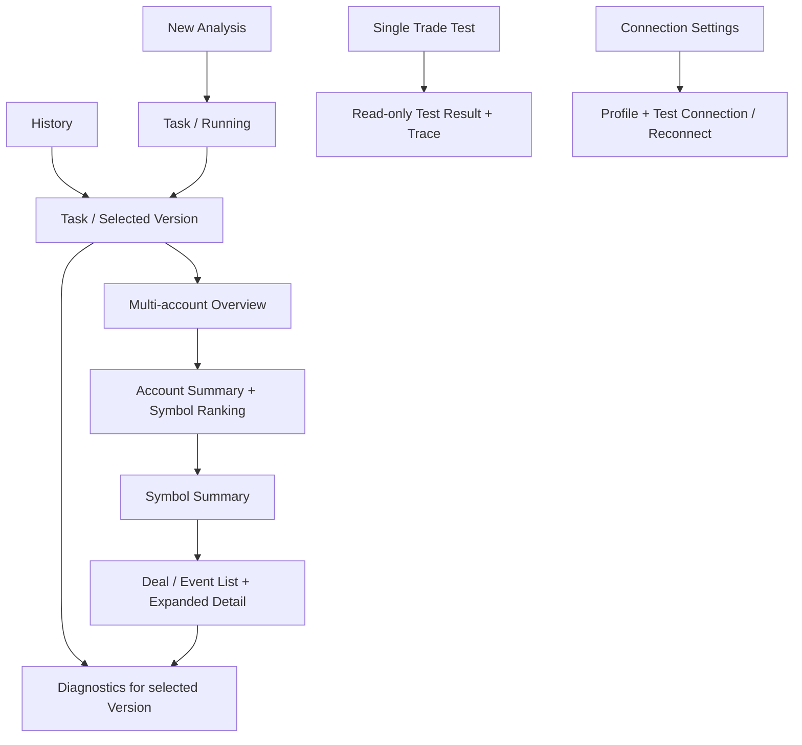

# UI/UX Specification

状态：DRAFT FOR ARCHITECTURE REVIEW。仅界面行为与设计规范，不是正式 UI、可运行原型或实施授权。

## 1. 依据、约束与证据边界

本文以用户 §0–126、[Decision Register](01-product-scope-and-decisions.md)、[Architecture](02-system-architecture.md)、[Logical Model](04-data-model.md)、[State/Error Model](05-state-and-error-model.md) 为依据。计算定义以 [Calculation Specification](03-markout-calculation-spec.md) 为准。业务未决项统一进入 [Open Questions](09-open-questions.md)，本文不替代其决定。

应用 UI/UX Pro Max 的桌面表格、渐进展开、焦点、DPI、主题原则，以及 product-design-and-ux 的 IA、任务流、状态恢复、界面契约与可观察验收方法。两 Skill 是方法来源，不是业务规则来源；WPF 示例不构成选用 WPF 的理由。文中 **CONFIRMED** 指 Dxx 已确认规则，**PROPOSED UX** 指待 Review 的呈现或交互方案。没有用户研究、真实 SDK 联调、性能测试或无障碍合规测试证据。

目标用户为单人 Windows 桌面风控分析人员。目标是找到账户、定位品种、检查真实成交与数据缺失，并能返回原分析位置。数据只说明 Markout 与质量事实，不替用户判定风险、可信度或 Toxic Flow（D01、D23、D44）。不增加登录、RBAC、共享、云同步或审计工作流。

| 用户结果 | 设计契约 | 规则依据 | 可观察完成证据 |
|---|---|---|---|
| 用少量输入开始多账户分析 | UX-01 New Analysis、UX-02 Running | D02–D06、D33–D35 | 保存任务标识，阶段明确；最终发布状态与结果一致 |
| 从账户找到品种再核查成交 | UX-04 Overview、UX-05 Account、UX-06 Symbol、UX-07 Event | D22–D28、D42 | 每层范围可见；返回还原筛选/窗/排序/行位置 |
| 判断缺失发生在哪里 | UX-08 Diagnostics | D03、D14、D29 | 账户、事件、窗口及原因可定位；环境故障不伪装为报价缺失 |
| 单独核验一笔真实成交 | UX-09 Single Trade Test | D30 | Manager 原始记录与同引擎计算证据可读，结果不进入正式汇总 |
| 重看或重新运行历史分析 | UX-03 History/Version、UX-A03 Re-analyze | D21、D31–D32、D46 | 历史离线读取；新版本独立；旧版不被覆盖 |
| 保存或移除所选任务结果 | UX-A01 Export、UX-A04 Delete | D39–D41 | 导出绑定版本；删除先说明全部版本范围并二次确认 |
| 修复绑定环境问题 | UX-10 Connection Settings | D02–D03、D36 | Test/Reconnect 对应明确 Profile 与检查项，无跨 Profile 替换 |

## 2. 设计方向与界面基础

**PROPOSED UX**：克制、紧凑、适合长时间核查的桌面工作区。设计拨盘为 Variance **2/10**、Motion **1/10**、Density **8/10**。采用表格、排名、单曲线和逐层详情；不用卡片墙、彩色等级徽章或总览评分。

主内容优先显示当前分析上下文、关键 Money、Analyzed/Total 和下一步下钻。Price/Mid/Quote Time/Quote Age/Calculation Trace 放在详情、诊断和测试；其中 Quote Age 是事实，不配 stale 阈值或好坏结论。

### 2.1 语义设计令牌（方案，非代码）

| 令牌组 | 语义角色 | 使用要求 |
|---|---|---|
| Surface | Window、Content、Inset、Overlay | 表格与页头分层，少用阴影；不依赖装饰背景传达状态 |
| Text | Primary、Secondary、Disabled、Numeric、Link | 数值采用对齐数字；Secondary 仍须可读 |
| Border/Focus | Subtle、Strong、Divider、Focus | 焦点与选中为不同视觉状态；高对比主题保留二者 |
| Action | Default、Hover、Pressed、Selected、InactiveSelected | 只代表交互，不代表账户质量 |
| Feedback | Information、Failure、Progress | 错误有文本与原因；正负数有正负号，不能只靠颜色 |
| Typography | PageTitle、SectionTitle、Body、Table、Caption、DiagnosticMono | 平台已有字体优先；不下载字体或图标库 |
| Space/Size | 4 DIP 基础节奏；Compact/Standard 控件及表格行 | 密度改变留白，不靠缩小必要文字或隐藏单位 |
| Motion | Immediate、BriefFeedback | 普通状态变更以立即反馈为主；减少动态时不损失信息 |

建议表格正文 14–16 DIP，紧凑行高约 28–32 DIP；在缩放、长字段或辅助输入需要时允许增长。数值是评审起点，不是冻结像素规格。V1 不因此增加复杂主题/密度设置页；先验证统一紧凑布局与 Light/Dark/Windows 高对比适配。

## 3. Information Architecture 与导航

**PROPOSED UX，沿用 §65 建议**：五个一级入口：New Analysis、History、Single Trade Test、Diagnostics、Connection Settings。前两个为日常工作；测试和诊断保持独立。左侧持久导航只表达位置，不堆技术模块名。

Version Detail 是任务的容器，不是第六个一级菜单。Symbol Ranking 是 Account Summary 的主表，不另开一级页面。Deal/Event List 属于账户或品种下钻内容；展开选中行可查看详情。面包屑示例：`History > Task DEMO-001 > V1 > Login 100001 > XAUUSD.r > Deal 700001`。它始终与实际绑定的 VersionId/Login/Symbol 一致。

页头简洁显示 Task、Version、Platform、分析时 Profile、Server Time 范围；账户与品种层再显示 Login/Symbol。长 Profile/Symbol 可换行或受控展开，不靠悬停才能识别完整后缀。当前版本状态与“最新版本状态”须分开，防止 V1 已完成而 V2 失败时混淆。

## 4. 导航与上下文恢复契约 UX-N01

**CONFIRMED**：下钻返回尽可能保留 Filter、Sort、Selected Window、Scroll/Context（D42）。以下是实现中立的恢复方案。

**PROPOSED UX**：每个视图以 `TaskId + VersionId + Login（如有）+ Symbol（如有）+ Surface` 绑定视图状态，不仅以 Login 或 DealId 绑定。状态包括筛选、选定关键窗口、排序及方向、选中稳定 EventId/行标识、展开项、滚动锚点与焦点来源。数据真值仍来自所选版本的持久化结果。

| 导航/变化 | 保留与恢复 | 不可用时反馈 |
|---|---|---|
| Overview → Account → Symbol → Event → Back | 恢复原页面状态、原行和附近位置；焦点回到触发下钻的行或按钮 | 行不再在筛选结果内则回到表头/筛选摘要，说明位置改变；不清空全部筛选 |
| Event → Diagnostics → 返回 Event | 带入 Version/Login/Event 与失败窗；返回原展开项与滚动位置 | 无匹配诊断时说明没有该范围的诊断，不跳到另一账户 |
| 收起详情或关闭非破坏性对话框 | 焦点回到展开/打开者 | 打开者消失时回到同表相邻可用行 |
| 改筛选/排序/关键窗口 | 当前选择明确显示；表格完整结果集按当前条件排序；重新定位稳定行 | 无匹配显示当前条件与 Clear filters；不显示假的空账户统计 |
| 用户显式切 Version | 先更新所有页头、数据源和可用选项；各版本分别保存视图状态 | 目标无该 Login/Symbol 时回到目标版本 Overview，并说明；绝不拿另一版本数据补位 |
| 后台新 Version 完成/失败 | 仅出现简短状态提示和显式打开入口；当前所看版本不自动替换 | 失败不抹除旧版本，不默认跳旧成功版伪装最新版成功 |
| 从 History 再次打开任务 | 明确打开的版本；已访问版本可恢复当前会话内视图状态 | 初次打开所选版本时按该页面已定义默认；不自动调用 Terminal |
| Resize、DPI、Light/Dark 切换 | 不改变筛选、版本、选中项或运行任务 | 以行标识而非仅像素偏移尽量保持阅读位置 |

新版本不继承可能使结果误读的隐含筛选。若评审采用跨版本保留兼容筛选，必须显示已保留条件、验证其合法性并解释失效项；不得无声地把 OUT_BY 改成 ALL。V1 不建立复杂版本对比功能。

未提交 New Analysis 输入建议在当前应用会话内导航后保留；不自动提交。跨重启草稿和最后导航的持久化不是已确认功能，暂不纳入必需契约。正式任务恢复按 Q19 与 [05](05-state-and-error-model.md)；不能把 UI 的返回恢复称作 Pause/Resume。

## 5. 页面契约

### UX-01 New Analysis

依据 D02–D06、D11、D33、D34；入口为主导航或空 History。结果是一个明确标识的已保存任务，点击按钮本身不代表分析完成。

| 内容/控件 | 可观察行为与验证 | 状态/恢复 |
|---|---|---|
| Platform | MT4/MT5 单选，标签一直可见 | 切换后 Profile 列表限定同平台；旧绑定不兼容时清空并说明 |
| Connection Profile | 显示 Name 与 Platform；只选择明确同平台绑定 | 未配置时提供 Connection Settings；返回保留其余草稿；不代选另一 Profile |
| Accounts | 多行输入；接受换行、逗号及经确认的常见分隔；保留完整 Login 字符串 | Analyze 时解析、去重、Manager 验证；显示输入数/去重数与无效项，不删掉用户纠正所需信息 |
| Time Range (Server Time) | From、To 均明确 Server Time；不默认转换本机时间 | 必填、格式、From/To 合法性在提交前反馈；边界包含性/输入粒度见 Q06/Q25，不假定当天末尾 |
| Remark (Optional) | 简单多行或短文本备注，无标签系统 | 可为空；验证失败保留 |
| Analyze | 单一主动作；防重复提交；提交成功显示 TaskId/所建 Version | 持久化失败不声称已排队；网络或验证失败保留输入并提供具体恢复 |

不提供 Symbol、Windows、Point、公式、线程、Tick 策略、数据库设置或 Excel/CSV 账户导入。大时间范围不设置人为上限，不要求手动拆日期。

局部字段错误就近显示，提交时聚焦第一个可纠正字段并给简短摘要。Manager 返回 ACCOUNT_NOT_FOUND 时，对该 Login 显示原因，其余有效账户继续（§79）。全部无效的终态见 Q14；已创建任务及诊断照常保留。非 USD 账户行为见 Q08；不能用“账户不存在”替代币种或权限问题。检查 Manager 失败属于环境错误，不把全部 Login 标成无效。

### UX-02 Running Task / Queue

依据 D03、D33–D35。任务页固定保留 TaskId、Version、Platform/Profile、Accounts 数、Server Time 范围和备注；用户离开页面不等于取消任务。

| 情形 | 显示内容 | 动作/完成证据 |
|---|---|---|
| PENDING | 排队中；已保存输入；不显示伪进度 | Cancel；History 可回到任务 |
| RUNNING | Preflight、Manager History（含账户验证）、Symbol Specification、Tick Loading、Markout Calculation、Saving Result 的真实阶段 | 阶段来自执行器，不能由 UI 定时器模拟 |
| 数量已知 | Accounts 已处理/已知总数；Events 已处理/已知总数；注明当前阶段语义 | 不把“事件已读取”写成“事件已分析” |
| 数量未确定 | “正在读取账户历史/总事件数尚未确定”，Indeterminate | 不先填 0%，不推测 ETA |
| 有限重试 | 哪个环境检查或读取暂失败、“正在重试”及诊断入口 | Retrying 只是过程描述；不新增任务业务状态或用户重试参数 |
| Cancel requested | “正在取消；等待当前读取结束”或实际阶段事实 | 不重复发送；确实停止/保存状态后才显示 CANCELLED |
| Saving/Publish | 保存阶段与明确完成反馈 | 只有成功发布并可读后才显示 COMPLETED/正式 Summary；SQLite 失败不能用100%掩盖 |

已产生的诊断可以查看；未发布的结果不能显示成正式 Account/Symbol Summary。Cancel/完成提交竞争采用 [05](05-state-and-error-model.md) 的 PROPOSED 机制：成功已发布则明确“任务已完成”，不同时宣称取消成功。SDK 不能立即取消的限制见 Q24。

### UX-03 History / Task / Version Detail

依据 D21、D31–D32、D38、D46。History 只读本地已保存事实，Task Detail 以明确版本为单位，不因打开页面触发连接或 Tick 获取。

**PROPOSED UX，沿用 §59**：列为 TaskId、Platform、分析 Profile、Account Count、Time Range (Server Time)、Latest Version、Latest Version Status、Created Time、Task Remark。搜索 TaskId/Login/Remark，筛选 Platform/Profile/Status；没有 Markout 指标墙。Created/Analysis Time 必须标其实际时钟语义，不冒充 Trade Server Time（Q25）。

Task/Version 页提供 Version 选择、版本备注、Analysis Time、Calculation Rule Version，以及可展开的环境快照。打开 V1 时展示 V1 的状态与结果，旁列最新版本信息即可；不把最新失败状态覆盖 V1 已完成事实。历史 Profile 改名/删除时仍显示当时 Snapshot 名称/身份；现配置不同另行说明。

Completed 可下钻、Export、Re-analyze；Failed/Cancelled 显示本次失败/取消事实与诊断，旧 Completed 版本仍可显式打开。空历史显示 New Analysis；筛选无匹配显示 Clear filters。SQLite 读取失败显示“所选版本暂不可读取”，不连接 API 重造历史，不展示旧屏幕数值为当前版本结果。

### UX-04 Multi-account Overview

依据 D23、D28。每 Login 一行，始终独立；不增加跨 Login Total 行或跨 Symbol Points。

- 主要字段：Login、Analyzed/Total、Analysis Rate、Account 处理事实/原因、各关键窗口 Total Money Markout (USD)。
- MT5 主窗：100ms、500ms、1s、5s、30s、180s；MT4：1s、5s、30s、180s。
- Account 的 Waiting/Processing/Processed/Skipped 等为 [05](05-state-and-error-model.md) 的技术提案，不是新风险评级。
- 账户不存在行保留并带 ACCOUNT_NOT_FOUND 和诊断入口，不能显示为 0 笔有效成交；尚未完成读取的 Total 必须是未知。
- 行激活进入该 Login 的 Account Summary；表头与页头始终标 Version。Analysis Rate 分母、空值口径依 Q11；无完整依据不能自动填0%/100%。

### UX-05 Account Summary + Symbol Ranking

依据 D22–D24、D26。顶部为 Login 与范围，紧凑显示 Analyzed/Total、Analysis Rate，以及选定关键窗口的 Total Money Markout (USD)。不显示跨 Symbol Points 平均数。

Ranking 是主内容：完整 Symbol（含后缀）、Valid Event Count、Event Volume、选定窗口 Total Money Markout (USD)。是否附 Avg Money 可在同一表次级列展示；不是追加评分。**CONFIRMED** 默认 1s、Total Money 降序，支持平台关键窗口切换；排序箭头和单位可见，排序对完整筛选结果集生效。

Direction 支持 ALL/BUY/SELL；Entry/Event 支持平台对应取值。**Q16 未决**：Summary 是否允许同时组合二者。本文不把两个独立要求默认为交叉聚合。线框以独立“Summary View”占位表达评审选项，组合方式获批前不可实现。过滤后的计数/Analysis Rate 口径依 Q11，不沿用未标明范围的全账户计数误导用户。

点击 Symbol 进入 Symbol Summary；返回保持该账户窗口、排序、视图筛选和原 Symbol 行。OUT_BY 只有本版本实际存在时展示；不能为没有此数据的平台显示无意义选项。

### UX-06 Symbol Summary

依据 D22、D25、D26。页头显示 Task/Version/Login/完整 Symbol。主图一条 `Volume Weighted Avg Points Markout` 曲线，X 轴为全支持窗口：MT5 9点、MT4 7点。Money、Mid、Price 不叠加到图中。

图下按窗口提供可直接读取的表：Window、Valid Event Count、Event Volume、Avg Points Markout、Volume Weighted Avg Points Markout、Total Money Markout (USD)、Avg Money Markout (USD)。表与图使用同一已发布 VALID Event 集；不能每窗自选部分完整 Events。Event Volume 是事件量，MT4 OPEN/CLOSE 独立计数，不能写成唯一订单数或净持仓量。

方向/Entry 视图与 Account 的 Q16 一致，切换后图表范围说明同步。View Deals/Events 进入相同 Version/Login/Symbol 的成交表。无可聚合事件时解释原因并链接 Diagnostics，不画零曲线；数值占位/终态依 Q11/Q14。

### UX-07 Deal / Event List + Expanded Detail

依据 D17–D18、D25、D27、D29。一行一个 MT5 Deal 或 MT4 Event；MT4 Ticket 相同但 OPEN/CLOSE 是不同事件，行键不能仅 Ticket。

**PROPOSED UX**：主表固定身份列 DealId/Ticket、Event/Entry、Symbol、Side、Volume、Trade Time、Trade Price、Status；用关键窗口选择器显示该窗口的 Points Markout 与 Money Markout (USD) 两列。支持全部规定关键窗口，默认1s是呈现建议，不改变计算窗口。这样减少同时铺开的十二个数值列；所有窗口在展开详情和导出均保留。若 Review 要同时比对各关键窗，可用有单位的列组与表内横向滚动，不扩展为自定义指标编辑器。

Symbol/Side/Entry或Event/Status 过滤按 D27；Points/Money 可排序，当前排序窗口清楚可见。Detail 表的多条件筛选能力不等于批准 Summary 交叉聚合（Q16）。Status=DISCARDED 行可展开失败窗口；未得数值不能填0。主表 Trade Price 是成交字段，与隐藏的 Price Markout 不是同一概念。

展开内容采用“成交 / 窗口 / 核查”层次：

1. 成交：Profile/Platform/Login、Deal/Ticket、Event/Entry、Symbol、Side、真实 Volume/Price/Event Time、Source Time Precision；相关 Raw 字段只读。
2. 全窗口表：Window、状态/原因、Target Time、Matched Quote Time、Quote Age、Bid、Ask、Mid、Price Markout、Points Markout、Money Markout (USD)、Mid Markout（Price 差单位）。Mid Points/Mid Money 不新增。
3. 单条 Event Points Markout Curve，覆盖全部支持窗口；缺失不是0，不跨缺失点用虚构线值。被丢弃事件若有部分窗口结果，明确“部分证据，整 Event 未进入 Summary”。
4. 核查展开：所用 Symbol Specification、Calculation Rule Version、Calculation Trace、Copy Diagnostic；常规页面不默认展开整屏 Trace。

MT4 100ms/500ms 在能力说明中显示 UNSUPPORTED_TIME_PRECISION，不进入七点曲线、不算缺窗；如诊断用对照行展示，数值为不适用而不是零。详情关闭后回到原行焦点与滚动位置。

### UX-08 Diagnostics

依据 D03、D14、D29。入口为独立主导航，或从所选 Task/Version/Account/Event 带上下文进入；首次全局进入要求选择明确任务版本，不默默合并所有版本。

- 统计事实：Total、Analyzed、Discarded；原因列表显示计数单位。Environment/Account/Event/Window 分层。
- ACCOUNT_NOT_FOUND 计账户；多缺窗 Event 在 Discarded 中只算一次；按原因去重 Event 数可能重叠，界面注明；Window 数不与 Event 数相加。
- 点击原因进入受影响行，显示 Platform、Profile、Login、DealId/Ticket、Event Type、Symbol、Side、Event Time、Missing Windows、Target、Matched/Last Available Tick、Bid/Ask、Reason。不要把 Last Available Candidate 标成成功匹配。
- 一 Event 多失败窗全部保留，可展开逐窗；QUOTE_ACCESS_FAILED、终端离线、Server mismatch 不转换成成批 NO_QUOTE。
- Calculation Trace 逐步给出真实输入、所选 Bid/Ask、Price差、Point除法与所用 Money 方法/输入/输出及限制。说明 Q04 的无效候选语义须先解决，不能由 UI 决定回退旧 Tick。

Copy Diagnostic 是显式复制操作，输出 Event 身份、时间精度、所有窗口及 Target/Quote/Age/Bid/Ask/Mid/Price/Points/Money、Mid Price差、Spec、Rule、错误与环境身份；保留失败窗。使用白名单字段，排除凭据、连接密码、认证对象、Stack Trace 中可能含的秘密。只有剪贴板写成功后显示“已复制”；失败保留当前上下文。复制不是自动发送给 Developer、Codex 或任何外部服务。

普通错误区只给原因、影响范围、保留内容、下一步；技术 Stack Trace 仅在脱敏的技术详情/Technical Log 范围内，不能直接推到 Account 页面。无诊断时显示“当前范围无诊断记录”，不声称数据可信。

### UX-09 Single Trade Test

依据 D30。输入仅 Platform、同平台 Profile、Login；MT5 DealId，MT4 Ticket 与 OPEN/CLOSE。运行通过 Manager 获取真实记录并核对归属；使用与正式分析相同的预检、标准事件、匹配和 Markout Engine。

Symbol、Side、Volume、Price、Trade Time 只读；无手工构造、编辑或“覆盖计算值”入口。输入验证失败保留原值；环境失败进入检查项；记录不存在/归属不符给具体原因，不转成模拟数据。

结果独立标注 `Single Trade Test — TEST`，不能冒充 Task/Version。显示 Manager Raw Trade、Symbol Specification、Source Time Precision、全部支持窗与各窗 Target/Quote/Age/Bid/Ask/Mid/Price/Points/Money/Mid Price差、Event Points Curve、Calculation Trace、Copy Diagnostic。MT4不支持两窗作为能力说明。结果不进入 Account/Symbol Summary 或正式 History；长期保存与导出形式是 Q17，本文不新增 Test History 功能。

### UX-10 Connection Settings

依据 D02–D03、D36、D46。Profile 列表与选中项配置保持简单：Name、Platform、Manager Connection 信息、Terminal Binding/Connection 信息、Expected Server，以及受保护凭据配置入口。实际字段与安全存储机制须按 SDK/Q20 Review，不能伪造“已安全保存”的能力。

Test Connection 和 Reconnect 对选中 Profile 生效。检查明细至少 Manager connectivity、Terminal running、Terminal connected、Expected Server、Quote availability。Unchecked/Checking/Ready/Unavailable 是技术呈现建议；显示检查时点，不用一个无上下文绿灯代表永久可用。执行分析仍需实际 Preflight。

失败给出具体项与恢复动作；Server mismatch 显示非秘密预期/实际身份；不自动寻找相近终端或其他 Profile。配置测试不创建分析结果。Profile 重命名/修订/删除对正在运行任务及历史引用的行为待 Q15/Q18；线框不预设可直接删除被引用配置。历史已保存结果始终仍可读。

## 6. 关键动作契约

| ID/动作 | 入口、确认和效果 | 失败/恢复与开放项 |
|---|---|---|
| UX-A01 Export | 从显式 Version 发起；显示 TaskId/Version/Platform/Profile/Accounts/范围；选择 XLSX 或 CSV（多账户ZIP，单账户包装依Q21）、保存位置；完整版本字段，非当前可见列或当前筛选子集 | 完成后显示实际输出位置；失败不改 Task 状态，保留 Version 与格式/路径供重试；不得出现静默截断。Failed/Cancelled 与 Test 导出依 Q17，超大Excel策略 Q21 |
| UX-A02 Cancel | Pending/Running 可用；主动作旁说明取消保留记录和诊断、未完成结果不进正式 Summary；无 Pause/Resume | 取消中保持状态事实，直到确认完成；不滥用确认弹窗。若已完成发布则显示已完成，非取消成功 |
| UX-A03 Re-analyze | 显式说明将建 Vn+1，Vn 保留；显示原 Platform/Profile/Accounts/Server Time 范围与可选 Version Remark；不需要配置规则版本 | 是否改参数/使用已变 Profile revision 依 Q15。Profile缺失明确阻止原绑定重跑并链接设置，不偷偷替换；新版本失败仍保留旧版入口 |
| UX-A04 Delete Historical Task | 二次确认显示 TaskId、版本数量与删除范围：全部版本/关联结果/报价/诊断/快照；默认焦点为 Cancel；不可恢复后果明确 | 确认提交后才移除；失败保留行与上下文并说明。运行中任务、外部导出文件/独立日志边界依 Q18；不做单版本删除 |
| UX-A05 Copy Diagnostic | 当前 Event/TEST 显式按钮，复制白名单诊断文本 | 不包含凭据；不自动发送；反馈不抢走表格焦点 |

**PROPOSED，沿用 §62–63 建议**：XLSX 一个 Version 使用 Task Summary，加每 Login 的 Summary/Deals/Discarded；CSV 多账户 ZIP 每 Login 三类文件。精确 Sheet/文件名、长度、非法字符/重名与超行策略不是冻结 UI 文案或数据库 schema，交由 Q21 与后续设计；必须保持账户隔离与完整字段。Export 内容标明 Calculation Rule/Spec/Environment 与版本，不能暗用 latest。

## 7. 适用状态库存与恢复

以下状态是界面情况，不自动新增 Task Status。Task 只有已确认五态；Account/Event/Window/Connection 取自 [05](05-state-and-error-model.md)。

| 状态/触发 | 用户可见内容 | 可做与保留 | 禁止误导 |
|---|---|---|---|
| Empty / 初次无任务 | 尚无历史 + New Analysis | 清楚的下一步 | 空图不假装0结果 |
| Loading / 读本地结果 | 正在读取所选 Version | 页面结构稳定、可导航；保留版本范围 | 旧版值不得冒充新版；不先补0 |
| Running / 任务执行 | 阶段、真实数量或未知总数 | Cancel、History、Diagnostics | 不输出正式部分 Summary/虚假ETA |
| Partial Account Validation Failure | 无效Login及原因、有效账户继续 | 查看问题，不要求重新粘贴全部账户 | 不把环境失败归成账户不存在 |
| Task Failure | 失败阶段/简短原因/本次版本 | 查看诊断、修复后新版本 | 不覆盖旧版，不以部分结果装完成 |
| Connection Failure | 哪个Profile哪个检查失败 | Test/Reconnect/检查正确Terminal | 不归NO_QUOTE、不切其他Profile |
| No Valid Events | 已知计数和“无可聚合事件”事实 | 看事件/诊断、返回；范围筛选可清除 | 空指标Q11与终态Q14待定，不擅定0/COMPLETED |
| All Events Discarded | Total/Discarded与原因入口 | 看全部失败窗 | 不画零曲线，不输出风险或可信度 |
| Filter No Match | 明确当前筛选无匹配 | Clear filters、保留其他上下文 | 不宣称账户无交易 |
| Export Failure | 指定Version/格式/失败文件动作 | 重试或换保存位置 | 不把Completed Task改FAILED |
| SQLite Failure | 读取/保存何者失败、哪些已保存事实可用 | 查看脱敏技术详情；保持输入/旧版本 | 不保证写失败诊断必已保存，不联网重造历史 |
| Cancelled Task | CANCELLED、停止阶段、结果不完整 | 诊断、Re-analyze新Version | 不暴露Resume，不发正式部分Summary |
| Historical Profile Missing | 历史环境快照、当前绑定不可用 | 读历史/合规导出；查看配置 | 不禁读历史、不静默换Profile重跑 |
| Re-analysis Failure | Vn失败，旧版明确可选 | 诊断/修复后新Version | 当前视图不自动跳成旧成功版 |
| Restart after Running | 有遗留执行记录、尚未评审恢复语义 | 用户看到真实已持久化状态与说明 | Q19未结不采用INTERRUPTED，不标完成，不自动Resume |
| Permanent Delete Failure | Task仍存在、删除未成功 | 保持History定位与重试上下文 | 不先移除后无恢复说明 |

不适用的状态：账号登录/RBAC拒绝、多用户冲突、云同步冲突、外部邀请或审批流；它们超出 D01。Manager/Terminal 权限失败仍作为连接或读取错误处理，不能因没有 RBAC 就忽略。没有研究或测试证据能证明上述流程已经可用；表是未来可验证契约。

## 8. 表格、曲线与数值内容规范

### 8.1 表格

**PROPOSED UX**：身份/文本左对齐，数值右对齐；日期时间采用一致对齐；单位在表头，完整 Symbol 后缀与 ID 保留。固定少量身份列和表头，横向滚动限于表格，不使全窗口左右移动。大列表按需加载/虚拟化，不一次渲染所有 Event；不会只排序当前可见页面。

单击选择、明确展开按钮或 Enter 激活详情；行选中与键盘焦点不同。常用操作有可见按钮，不仅右键。排序方向、选定窗口、筛选摘要与 Clear filters 可见。加载、空数据、无匹配、失败用不同语句；筛选/排序触发后保留可追溯范围，不用旧值闪成新值。

### 8.2 曲线

Symbol：Y=Volume Weighted Avg Points Markout；Event/Test：Y=Points Markout。X 标签列明实际 Window，按固定顺序；**PROPOSED UX** 用离散窗口等距排布，明确“窗口序列，非连续等时间间隔”，避免把100ms到500ms与60s到180s误读成相同时间跨度。不能添加平滑拟合、插值数值或 Money/Mid/Price 曲线。

正负围绕清楚的0参考线；视域不可掩盖符号；缩放方案不得夸大幅度。每一点有可通过键盘/旁表读取的数值，Tooltip 仅补充。重要曲线有同源数据表替代，不依赖颜色、悬停或动画。没有结果不画一条0线冒充结果；支持窗部分证据保留缺口并标明 Event 已丢弃。

### 8.3 数字、时间与术语

| 内容 | 确定要求 | 待 Review 的呈现规则 |
|---|---|---|
| ID/Login/Ticket/Deal | 原值无损；不可科学计数、浮点取整或插入千分位导致复制错误 | 展示全文，过长可水平查看/复制明确字段 |
| Symbol | 原完整名称与后缀 | 不缩写成基础品种名 |
| Markout | 正值客户有利、负值客户不利；Points 名称固定，Money标USD | 建议正值显式+，负值−；颜色仅辅助；零与缺值不同 |
| Price/Bid/Ask/Mid | 来自保存数据/Spec；价格不是Pips | 以Spec精度显示但不截断计算真值；差值精度与舍入Q25 |
| Volume | Event实际Volume及明确Lots单位；不称Net Position | 显示精度依源/合约，Q25；不能为紧凑而丢小量 |
| Trade/Target/Quote Time | Server Time；MT5毫秒，MT4源SECOND，计算表示可`.000` | MT4旁注“秒级源时间”；不暗示真实毫秒测量 |
| Quote Age | Target−Quote时间，单位明确；不设stale阈值 | 建议ms精确值配可读时长，不能以颜色判太旧；格式Q25 |
| Analysis Rate | 基于确认口径；不是Confidence | 小数位、零分母、过滤后范围Q11/Q25，获批前不填0/100% |
| Mid Markout | 仅Mid价格差；不新增MidPoints/MidMoney | 列名注明Price单位，避免与主指标混淆 |
| 无值/不适用/失败 | 状态与原因保留；从不把缺失写0 | 占位符/文字统一待Q11/Q25；线框的“未获得”只为解释，不冻结数学返回值 |

Copy/Export 保留完整被批准精度及单位；不能用格式化文本反推计算。Money 是理论价格变动对应 USD，不显示“实际盈亏”或含费用净收益。Raw Profit/Commission/Swap 单列核查，绝不与 Markout 混名。

## 9. 键盘、鼠标、DPI、主题与重排

**PROPOSED UX 可验证要求**：

- Tab/Shift+Tab 按导航→页头→筛选→表格→动作的逻辑顺序；焦点可见，不以正 TabIndex 修补视觉结构。Enter/Space 激活控件，表格方向键移动，Escape关闭详情/非破坏性对话框并恢复焦点；Escape不暗中取消任务。
- 所有鼠标下钻、筛选、窗切换、Copy、Export、Cancel 都有键盘路径。图标动作有名称和可见说明；重要动作保留文字。工具提示不是唯一信息来源。
- 表格可感知列名、单位、选中行、排序方向、展开状态与当前窗口；加载/复制结果用不抢焦点的状态反馈。原生无障碍语义与辅助技术验证在选定栈后评审，本文不宣称符合某认证。
- 宽度不足时页头和筛选换行，次要动作进入有明确标签的菜单；表格内部横滚。内容详细区可改为单列阅读顺序，返回上下文不丢；不把关键动作或单位截掉。
- 125%/150%/200% DPI、长Profile/Symbol、长原因、多位ID、放大文字均须走查；不固定高度裁切多行错误或按钮。最小窗口尺寸待真实 Windows 原型验证，不现在锁定像素。
- Light/Dark/高对比使用语义角色，保留焦点/选中/错误文字。普通文本建议至少4.5:1对比，大文本与必要图形至少3:1；这是设计目标，尚未测量。正负与状态不用红绿单独编码。
- 尊重减少动画；表格刷新、阶段更新不闪烁或持续重排。复杂计算和连接等待不阻塞输入；真实性优先于连续百分比动画。
- UI 文案的最终语言与本地化范围尚未冻结；本规范保留用户要求的英文域名词。文本扩展不得隐藏 `Server Time`、版本或单位，不新增未请求的语言设置功能。

## 10. 内容、保密与交接边界

错误文案四要素：发生什么、影响哪个范围、已保留什么、下一步。例：“MT5-Live-A 的 Terminal 未连接，本次计算尚未开始。任务输入已保留。请检查该 Profile 的连接，再重新分析。”只有相应事实已确认才使用该句，不在 SQLite 写失败时保证记录已保存。

不增加产品分析埋点、User Audit Log 或云遥测。允许的 Technical Log 最小字段为阶段/任务版本关联/脱敏错误/必要SDK状态，目的是排错；没有凭据、用户输入全集或默认屏幕内容采集。Copy Diagnostic/Export 同样经过字段白名单。读取历史不得触发 Terminal 请求或当前环境自动修复。

UX 输出为可观察合同；具体控件、框架、存储实现、线程/页大小留在后续 Technology Stack 与 Implementation Review。不得把 Qxx 未决用默认值编码。

## 11. UX Review 与验收交接

线框见 [07](07-wireframes.md)，正式 Given/When/Then 汇总见 [08](08-acceptance-criteria.md)。评审至少走查以下路径；此处是待执行方案，不是已通过的测试结果。

| Probe | 入口/操作 | 必须观察 |
|---|---|---|
| UX-P01 | 粘贴重复Login、一个不存在、两个有效账户→Analyze | 去重反馈；有效继续；无效账户保留；无跨Login合并 |
| UX-P02 | 正在读取未知总数→离开→History返回→Cancel | 真实阶段恢复；无虚假ETA；收到取消完成前不报Cancelled |
| UX-P03 | V1 Account窗5s、排序/过滤→Symbol→Event→Back | Version/Login/Window/筛选/行/焦点恢复；无Summary交叉假设 |
| UX-P04 | 打开无可用Profile的Completed历史版本 | 所存结果可读且不联网；Re-analyze说明原绑定不可用 |
| UX-P05 | V1正在查看，V2后台失败 | V1保持原视图；V2失败可显式打开；无版本混用 |
| UX-P06 | 一个Event两缺窗→Diagnostics→Copy | 事件计数一次、失败窗两条；Copy无凭据；不显示0值 |
| UX-P07 | 单笔Test核验MT4 CLOSE与MT5 Deal | 输入真实ID，源字段只读；同引擎；无正式History/Summary污染 |
| UX-P08 | Export失败→重试；Delete→取消二次确认 | Export绑定相同版本且不改Task状态；未确认不删除 |
| UX-P09 | 仅键盘，200%DPI，高对比，长Symbol/ID | 核心动作可达、标签和单位完整、表格局部滚动、焦点恢复 |
| UX-P10 | 无成交/全丢弃/全部账户无效 | 事实可见，Q11/Q14的评审决定可追溯，不悄悄造数学值或终态 |

阻止实施的未决关联：Q06（范围端点）、Q08–Q14（资格/空值/终态）、Q15（重分析与配置修订）、Q16（Summary组合）、Q17（不完整/测试导出保存）、Q18（删除/引用）、Q19（重启）、Q20（凭据）、Q21（超大导出）、Q24（SDK取消等）、Q25（显示精度）。技术可行性Q01–Q03同样不能被可用的线框掩盖。

§110 覆盖：IA/Navigation/Primary Journey见§3–4；New Analysis、Running、Overview、Account、Ranking/Symbol、Event、Test、Diagnostics、History/Version、Settings见§5；状态见§7；Cancel/Delete/Re-analyze/Export见§6；上下文恢复见§4；键鼠/DPI/Theme见§9；Table/Chart/Number见§8。所有项仍须 Architecture Review，完成文档后停止，不进入正式UI实现。
