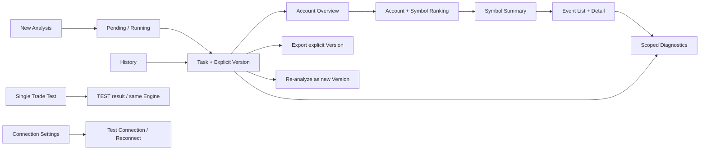

# Low-fidelity Wireframes

状态：DRAFT FOR ARCHITECTURE REVIEW。本文只有 ASCII 与 Mermaid 结构，不是正式 UI、HTML 应用、可运行程序或实施授权。

全部 Profile、Task、Login、Deal/Ticket 以及界面示例均为**明确假数据/布局占位**；`[saved value]` 表示从所选版本读取的值，并非本轮执行过计算。公式例子与完整7/9窗 fixtures 以 [03](03-markout-calculation-spec.md) 为准。截图式排版不冻结像素、框架或数值精度。

五入口、页内结构、窗口选择器、对话框排版属于 **PROPOSED UX**；冻结规则见 [01](01-product-scope-and-decisions.md)。行为/错误/焦点与恢复以 [06](06-ui-ux-specification.md) 为准；状态以 [05](05-state-and-error-model.md) 为准。OPEN QUESTION 注解是评审说明，不应直接变成产品内的 `Qxx` 标签。

## 1. 路径总图



结果页的 Back 是恢复原视图状态，不是重新读取交易服务器。Version 改变必须可见，后台新版本完成也不自动替换当前页。所有层级路径始终含 Task/Version，并按需包含 Login/Symbol/Event。

## WF-01 — New Analysis（UX-01）

```text
+------------------------------------------------------------------------------------------------+
| Markout Analyzer                                                                               |
+--------------------+---------------------------------------------------------------------------+
| > New Analysis     | New Analysis                                                              |
|   History          | Analyze real trade events within a Server Time range.                     |
|   Single Trade Test|                                                                           |
|   Diagnostics      | Platform                 ( ) MT4  ( ) MT5                                 |
|   Connection       | Connection Profile       [ DEMO-MT5-A                               v ]   |
|   Settings         |                                                                           |
|                    | Accounts                                                                  |
|                    | +---------------------------------------------------------------------+   |
|                    | | 100001                                                              |   |
|                    | | 100002, 100003                                                      |   |
|                    | +---------------------------------------------------------------------+   |
|                    | Paste logins separated by lines or supported separators.                  |
|                    |                                                                           |
|                    | Time Range (Server Time)                                                  |
|                    | From [ YYYY-MM-DD hh:mm:ss... ]   To [ YYYY-MM-DD hh:mm:ss... ]            |
|                    |                                                                           |
|                    | Remark (Optional)                                                         |
|                    | [                                                                       ] |
|                    |                                                                           |
|                    |                                                           [ Analyze ]     |
+--------------------+---------------------------------------------------------------------------+
```

提交时解析/去重/验证，不增加独立的强制向导步骤。日期字段占位的精度和包含性留 Q06/Q25，不预填本机时间。Profiles 仅显示同平台绑定；无 Profile 时在原位置提供“配置连接”，其余草稿保留。

局部失败变体：

```text
Accounts
[ original pasted input retained                                           ]
ACCOUNT_NOT_FOUND: 100003
2 valid accounts continue. The invalid login remains visible in diagnostics.
```

上句仅适用于已验证的部分无效账户；Manager 连接失败不可显示该结果。全部无效时的终态是 Q14，已创建任务及诊断仍保留；非USD账户策略是 Q08。按用户§79，部分无效账户不能阻止有效账户继续。

## WF-02 — Pending / Running Task（UX-02、UX-A02）

```text
+------------------------------------------------------------------------------------------------+
| History > Task DEMO-001 > V1                                                                    |
| MT5 | Profile: DEMO-MT5-A | Accounts: 3 | Range: [from] -- [to] (Server Time)                     |
+------------------------------------------------------------------------------------------------+
| Status: RUNNING                              [ View Diagnostics ]               [ Cancel ]      |
| Stage: Tick Loading                                                                            |
|                                                                                                |
| Preflight -> Manager History -> Symbol Specification -> TICK LOADING -> Calculation -> Saving   |
|                                                                                                |
| Accounts: 2 / 3 processed                                                                      |
| Events: [processed] / [known total]                                                            |
| [ progress for this measurable stage only                                                  ]  |
|                                                                                                |
| Input remark: [saved task remark]                                                             |
|                                                                                                |
| Recent issue: Account 100003 was not found. Other valid accounts continue. [Details]             |
|                                                                                                |
| Results will be available after calculation and saving are complete.                            |
+------------------------------------------------------------------------------------------------+
```

未知总数变体用“正在读取历史；总事件数尚未确定”与不定进度；不显示假百分比/ETA。PENDING 显示“队列中”和 Cancel，不显示计算阶段已推进。

Cancel 请求后，按钮区域显示“正在取消；等待当前读取结束”（若该事实成立）。这是 RUNNING 下技术阶段，不新增业务状态；只有实际停止并确认状态后显示 CANCELLED。已发布完成则显示 COMPLETED，不能同时说取消成功。取消记录与诊断保留，不提供正式部分 Summary或Resume。

## WF-03 — History（UX-03）

```text
+------------------------------------------------------------------------------------------------+
| History                                                             [ New Analysis ]           |
| Search Task ID / Login / Remark [                                   ] [ Search ]                |
| Platform [ All v ]   Profile [ All v ]   Status [ All v ]  [ Clear filters ]                    |
+------------------------------------------------------------------------------------------------+
| Task ID  |Platform|Profile    |Accounts| Server Time Range |Latest|Latest Status|Created |Remark  |
|----------+--------+-----------+--------+-------------------+------+-------------+--------+--------|
| DEMO-001 | MT5    |DEMO-MT5-A |   3    | [from] -- [to]    | V2   | FAILED      |[time]  |[text]  |
| DEMO-002 | MT4    |DEMO-MT4-A |   1    | [from] -- [to]    | V1   | COMPLETED   |[time]  |[text]  |
| ...                                                                                            |
+------------------------------------------------------------------------------------------------+
| [ Open selected task ]                                                     [ Delete task... ]  |
+------------------------------------------------------------------------------------------------+
```

Latest Status明确代表最新版本。V2失败并不删除V1；进入任务后仍可选择V1。历史页不用 Money/Points 指标墙。Table 搜索/筛选对完整数据集合生效，不仅当前显示页。

- 初次空：`尚无历史任务。[New Analysis]`。
- 筛选无匹配：`当前筛选无匹配任务。[Clear filters]`。
- 本地读取失败：明确无法读取历史与诊断入口，不伪装空历史或自动连接 Manager。

## WF-04 — Task / Version + Multi-account Overview（UX-03、UX-04）

```text
+------------------------------------------------------------------------------------------------+
| History > DEMO-001                                                                              |
| Selected Version [ V1 v ]  Status: COMPLETED      Latest Version: V2 (FAILED) [Open V2]           |
| MT5 | Analysis profile: DEMO-MT5-A | [from] -- [to] (Server Time)                                |
| Analysis Time: [labelled time] | Rule: [saved rule] | Version Remark: [text] [Environment]        |
| [ Re-analyze... ]   [ Export V1... ]   [ Diagnostics V1 ]                                       |
+------------------------------------------------------------------------------------------------+
| Accounts — each login is independent                                                          |
| Login |Analyzed / Total|Analysis Rate|Account result |100ms USD|500ms USD|1s USD|5s USD|30s|180s  |
|-------+----------------+-------------+---------------+---------+---------+------+-------+----+------|
|100001 |[saved counts]  |[saved rate] |[saved state]  | [saved] | [saved] | ...  | ...   | ...| ...  |
|100002 |[saved counts]  |[saved rate] |[saved state]  | [saved] | [saved] | ...  | ...   | ...| ...  |
|100003 |not established |not defined  |ACCOUNT_NOT_FOUND| not obtained; see account diagnostic       |
+------------------------------------------------------------------------------------------------+
| [ Open Account 100001 ]                                                                         |
+------------------------------------------------------------------------------------------------+
```

该表的 `not established/not defined` 是说明未获得事实的线框文字，不冻结 Q11 的最终占位或数学结果。无效账户没有可知 Event 总数，不能显示成0笔交易。Money列全为 `Total Money Markout (USD)`；不增加跨Login总计或跨Symbol Points。

MT4 变体只显示1s/5s/30s/180s四个Money列。Current Profile缺失或改名时，页头仍显示分析时环境快照；附加“原连接当前不可用，历史结果仍可读”，不因为此情况禁读V1。

## WF-05 — Account Summary + Symbol Ranking（UX-05）

```text
+------------------------------------------------------------------------------------------------+
| History > DEMO-001 > V1 > Login 100001                                           [ Back ]       |
| MT5 | DEMO-MT5-A | [from] -- [to] (Server Time)                                                  |
| Analyzed [N] / Total [T] | Analysis Rate [saved rate]                                           |
+------------------------------------------------------------------------------------------------+
| Key Window: [100ms] [500ms] [1s selected] [5s] [30s] [180s]                                     |
| Total Money Markout (USD), selected window: [saved value]                                      |
| Summary View: [ reviewed Direction or Entry view ]                                             |
|                                                                                                |
| Symbol Ranking                           Sort: Total Money Markout (USD), descending           |
| Symbol       |Valid Events|Event Volume (lots)|Total Money Markout (USD)|Avg Money (USD)         |
|--------------+------------+-------------------+------------------------+------------------------|
| XAUUSD.r     | [N]        | [saved volume]    | [saved value]          | [saved value]          |
| EURUSD.r     | [N]        | [saved volume]    | [saved value]          | [saved value]          |
+------------------------------------------------------------------------------------------------+
| [ Open Symbol XAUUSD.r ]                                         [ View Deals ] [ Diagnostics ] |
+------------------------------------------------------------------------------------------------+
```

CONFIRMED默认1s和Total Money降序。Summary View占位用于Q16评审：需要支持Direction ALL/BUY/SELL及平台Entry/Event取值，但未批准同时组合的交叉聚合；不可把线框实现为随意组合过滤。OUT_BY仅实际存在才显示。

从Symbol返回，恢复窗口、筛选/视角、排序、原Symbol行与焦点。指标说明必须标明作用范围；Q11未决时不得无声改变Analysis Rate分母。

## WF-06 — Symbol Summary / Curve（UX-06）

```text
+------------------------------------------------------------------------------------------------+
| History > DEMO-001 > V1 > Login 100001 > XAUUSD.r                                 [ Back ]       |
| Summary scope: [approved Direction / Entry view]                                                |
+------------------------------------------------------------------------------------------------+
| Volume Weighted Avg Points Markout                                                             |
|                                                                                                |
| [ one curve using the selected version's saved VALID-event aggregate ]                         |
| [ zero reference shown; no Money, Mid or Price overlay ]                                        |
|                                                                                                |
|     100ms   500ms    1s     3s     5s     10s     30s     60s     180s                            |
|     Window sequence (discrete; spacing is not elapsed time)                                     |
+------------------------------------------------------------------------------------------------+
| Window|Valid Events|Event Volume|Avg Points|VW Avg Points|Total Money USD|Avg Money USD            |
|-------+------------+------------+----------+-------------+---------------+-------------------------|
| 100ms | [saved]    | [saved]    | [saved]  | [saved]     | [saved]       | [saved]                 |
| 500ms | [saved]    | [saved]    | [saved]  | [saved]     | [saved]       | [saved]                 |
| 1s    | [saved]    | [saved]    | [saved]  | [saved]     | [saved]       | [saved]                 |
| ... all supported windows, including 3s / 10s / 60s ...                                        |
+------------------------------------------------------------------------------------------------+
| [ View Deals / Events ]                                                     [ Diagnostics ]    |
+------------------------------------------------------------------------------------------------+
```

图占位没有画假趋势。图与表同源且只用全支持窗完整的统一VALID集合。MT4变体为7窗，移除100/500ms。没有可聚合事件显示说明与诊断入口，不渲染零曲线；空集合与终态依Q11/Q14。

## WF-07 — Deal / Event List + Expanded Detail（UX-07）

```text
+------------------------------------------------------------------------------------------------+
| DEMO-001 > V1 > Login 100001 > XAUUSD.r > Deals                                   [ Back ]       |
| Symbol [XAUUSD.r v] Side [ALL v] Entry [ALL v] Status [ALL v] [Clear filters]                    |
| Key Window [ 1s v ]   Sort [ Points Markout v ] [Descending]                                    |
+------------------------------------------------------------------------------------------------+
|Deal ID|Entry|Symbol   |Side|Volume|Trade Time (Server)|Trade Price|1s Points|1s Money USD|Status    |
|-------+-----+---------+----+------+-------------------+-----------+---------+------------+----------|
|700001 | IN  |XAUUSD.r |BUY |[real]| [saved TimeMsc]   | [saved]   | [saved] | [saved]    |VALID     |
|700002 | OUT |XAUUSD.r |SELL|[real]| [saved TimeMsc]   | [saved]   | [evidence if obtained] |DISCARDED|
+------------------------------------------------------------------------------------------------+
| v Deal 700001  [ Close detail ]                                                [Copy Diagnostic]|
| MT5 / DEMO-MT5-A / Login 100001 | Side BUY | Volume [real] | Time Precision: MILLISECOND         |
|                                                                                                |
| [ Event Points Markout Curve: one series, all 9 supported windows, zero reference ]             |
|                                                                                                |
| Window|State|Target Time|Quote Time|Age ms|Bid|Ask|Mid|Price MO|Points MO|Money USD|Mid MO (Price)  |
|-------+-----+-----------+----------+------+---+---+---+--------+---------+---------+----------------|
|100ms  | OK  | [saved]   | [saved]  |[...] |...|...|...| ...    | ...     | ...     | ...            |
|500ms  | OK  | [saved]   | [saved]  |[...] |...|...|...| ...    | ...     | ...     | ...            |
|... all 9 windows; horizontal scrolling is confined to this evidence table ...                 |
|                                                                                                |
| > Raw Manager fields     > Symbol Specification     > Calculation Trace                       |
+------------------------------------------------------------------------------------------------+
```

主表单选关键窗口显示Points/Money两列是PROPOSED UX；支持用户指定的全部关键窗，所有窗仍在详情/导出完整保留。若选择多窗列组方案，在Review中明确，不能删少算窗。

MT4变体：`Ticket + OPEN/CLOSE`明确为事件身份；CLOSE的Side使用规范化反向成交Side；Time Precision=SECOND，`.000`是计算表示。100/500ms只在能力说明中标UNSUPPORTED_TIME_PRECISION，不当失败窗或曲线点。

DISCARDED展开时，在顶部明确“整Event未进入Summary”，显示所有失败窗。部分已有窗口值是诊断证据，不可绘制为完整有效结果。Mid MO仅价格差，不新增MidPoints/MidMoney。关闭详情焦点回到原Event行。

## WF-08 — Diagnostics / Error Drill-down（UX-08）

```text
+------------------------------------------------------------------------------------------------+
| Diagnostics                                           [Return to Event / Version]             |
| Task [DEMO-001] Version [V1 v] Login [100001 v] Event [700002] [Clear event scope]                |
| Total [T] | Analyzed [N] | Discarded [D]                                                         |
+------------------------------------------------------------------------------------------------+
| Layer [Event / Window v]                                                                       |
| Reason                |Count     |Unit             |                                           |
|-----------------------+----------+-----------------+-------------------------------------------|
| INCOMPLETE_QUOTES     | [count]  | distinct Events |                                           |
| NO_QUOTE              | [count]  | distinct Events | [Show Events]                             |
| INVALID_QUOTE         | [count]  | distinct Events |                                           |
| Reason counts may overlap. Window counts are shown separately.                                 |
+------------------------------------------------------------------------------------------------+
| Event 700002 / SELL / XAUUSD.r / [real volume] / [Event Server Time]                              |
| Event Status: DISCARDED | Missing / failed windows: 500ms, 1s (illustrative structure only)       |
| Window|Reason        |Target       |Matched Quote|Last available candidate|Bid/Ask evidence       |
|-------+--------------+-------------+-------------+------------------------+-----------------------|
|500ms  |NO_QUOTE      |[target]     |not matched  |[if evidence exists]    |[not obtained]         |
|1s     |INVALID_QUOTE |[target]     |[per rule]   |[candidate evidence]    |[invalid field marked] |
+------------------------------------------------------------------------------------------------+
| Calculation Trace / source evidence / specification / rule / environment                       |
| [ white-listed evidence for the selected event and each window ]                               |
| [ Copy Diagnostic ]                                                  [ Technical Log detail ] |
+------------------------------------------------------------------------------------------------+
```

两窗例为说明布局而列的假情况，候选回溯语义/字段有效性须先由Q04/Q05确定。Last available candidate不是Matched Quote。无有效TimeMsc的事件不伪造TargetTime。

Environment视图显示具体Preflight/连接问题；ACCOUNT_NOT_FOUND视图计账户，不冒充Event数。一个Event多缺窗只计一次Discarded。Copy全部窗口、Rule、Spec与必要身份，不复制凭据或SDK认证对象，不自动发送给任何人。

## WF-09 — Single Trade Test（UX-09）

```text
+------------------------------------------------------------------------------------------------+
| Single Trade Test                                                                              |
| Platform [ MT5 v ]  Profile [ DEMO-MT5-A v ]  Login [100001]  Deal ID [700001]  [ Run Test ]     |
| MT4 variant: Login [100001]  Ticket [800001]  Event ( ) OPEN ( ) CLOSE                           |
+------------------------------------------------------------------------------------------------+
| TEST RESULT — separate from Analysis Tasks and Summaries                                       |
| Source: Manager API real trade record | Time Precision: MILLISECOND                            |
|                                                                                                |
| Manager Raw Trade Data (read-only)            Symbol Specification (read-only)                  |
| Login / Deal / Order / Position               Point / Digits / Tick Size / Tick Value          |
| Symbol / Type / Entry / Volume                Contract / Profit Currency / Calculation Mode     |
| Price / Time / TimeMsc / available fields     Source / capture context                          |
+------------------------------------------------------------------------------------------------+
| [ Points Markout Curve — all supported windows ]                                                |
| Window|Target|Quote Time|Age|Bid|Ask|Mid|Price MO|Points MO|Money USD|Mid MO (Price)|State/Reason    |
| ... all supported windows and evidence, no hand-edited values ...                             |
+------------------------------------------------------------------------------------------------+
| Calculation Trace                                                                             |
| [Actual BUY/SELL formula, saved numeric inputs, Point division, actual Money method/evidence]  |
|                                                                         [ Copy Diagnostic ]    |
+------------------------------------------------------------------------------------------------+
```

不提供Symbol/Side/Volume/Price/Time可编辑输入；在正式Manager记录取回前不出现人为构造的计算表。Test错误与普通任务共用来源/匹配/计算诊断。MT4两不支持窗作为说明而非失败。

长期保存与Test Export是Q17，没有添加测试History库或默认保存按钮。Copy标记TEST，不伪造正式Version。运行测试不改变当前正式Summary。

## WF-10 — Connection Settings（UX-10）

```text
+------------------------------------------------------------------------------------------------+
| Connection Settings                                                                            |
+-------------------------+----------------------------------------------------------------------+
| Profiles                | Profile: DEMO-MT5-A                                                 |
| > DEMO-MT5-A (MT5)       | Name [DEMO-MT5-A]   Platform [MT5]                                 |
|   DEMO-MT4-A (MT4)       | Manager connection [SDK-confirmed fields]                           |
| [ Add Profile ]         | Terminal binding   [SDK-confirmed fields]                           |
|                         | Expected Server    [non-secret identity]                            |
|                         | Protected credential configuration [mechanism pending Review]       |
|                         |                                                                      |
|                         | [ Save configuration ] [ Test Connection ] [ Reconnect ]            |
+-------------------------+----------------------------------------------------------------------+
| Last check: [labelled time]                                                                    |
| Check                  |Result      |Details                                                    |
|------------------------+------------+-----------------------------------------------------------|
| Manager connectivity   |[result]    |[specific fact]                                            |
| Terminal running       |[result]    |[specific fact]                                            |
| Terminal connected     |[result]    |[specific fact]                                            |
| Expected Server        |[result]    |[expected vs actual identity if mismatch]                  |
| Quote availability     |[result]    |[specific fact; not a guarantee of all requested history]  |
+------------------------------------------------------------------------------------------------+
```

配置与连接控件为概念占位，不能以此宣称SDK字段、安全凭据机制或MT4历史Tick能力已证明。凭据实现Q20，Profile修订/历史引用/删除与运行影响Q15/Q18。Test Connection成功不替代运行任务的Preflight，也不保证任意历史范围完整。

失败变体给具体检查项和恢复动作；无“自动寻找替代Profile”或“用其他平台行情补齐”。删除引用Profile的行为未决，不画一个无条件生效的删除按钮。

## WF-11 — Explicit Version Actions：Re-analyze / Export（UX-A01、UX-A03）

### Re-analyze 审阅面板

```text
+----------------------------------------------------------------------------+
| Re-analyze Task DEMO-001                                                    |
| A new version will be created. Existing versions will remain available.    |
| Source scope: MT5 / DEMO-MT5-A / Logins [saved list]                          |
| Range: [from] -- [to] (Server Time)                                         |
| Profile configuration: [identity/revision availability facts]               |
| Version Remark (Optional) [                                             ] |
|                                                                            |
|                                           [ Back ]  [ Create new Version ] |
+----------------------------------------------------------------------------+
```

原参数是否可修改、Profile revision变化如何处理仍为Q15；该面板未画可编辑新范围，不代表已冻结禁止修改。Profile缺失时说明不可用与配置入口，不开启另一绑定。创建后明确显示新Vn+1；失败返回新版诊断，旧版仍保留。

### Export 审阅面板

下方面板为多账户版本示例，因此显示CSV ZIP；单账户CSV的包装方式仍依Q21决定。

```text
+----------------------------------------------------------------------------+
| Export Task DEMO-001 / Version V1                                           |
| Platform: MT5 | Profile snapshot: DEMO-MT5-A                                |
| Accounts: [saved list] | Range: [from] -- [to] (Server Time)                 |
| Format: ( ) Excel XLSX     ( ) CSV ZIP                                     |
| Output location: [ chosen path                                         ]  |
| Includes full version data and all windows, independent of visible columns.|
| Credentials are excluded.                                                  |
|                                                   [ Cancel ] [ Export ]    |
+----------------------------------------------------------------------------+
```

只绑定V1，当前筛选/可见列不裁剪完整版本数据。账户独立；Sheet/文件精确命名沿用用户建议但仍为PROPOSED；大数据格式边界Q21。Failed/Cancelled及Test的导出范围Q17未决，不能把不完整Summary作为正式导出。

导出失败在同一版本动作中给出路径/占用/空间等适用原因、Retry或更换保存位置；Task的COMPLETED保持不变。成功在实际文件完成发布后显示输出位置，不提前宣称成功。

## WF-12 — 删除确认与关键异常变体（UX-A04、State Inventory）

### Delete Historical Task 二次确认

```text
+----------------------------------------------------------------------------+
| Permanently delete Task DEMO-001?                                          |
| This deletes all [N] versions and their results, matched quotes,           |
| diagnostics and snapshots. This cannot be undone.                          |
|                                                                            |
|                                    [ Cancel (initial focus) ] [ Delete ]   |
+----------------------------------------------------------------------------+
```

该对话框只说明已确认的整个Task关联数据删除。运行中任务、Profile删除、外部导出文件与独立日志的边界依Q18，不据此擅自删除其他文件。取消不改变数据；提交失败保留任务行及位置；成功后焦点回到History邻近行或空状态标题。不增加单Version删除或自动Retention。

### 其余关键异常（内联面板结构，避免大量确认弹窗）

```text
+------------------------------------------------------------------------------------------------+
| [Specific condition]                                                                           |
| What happened: [plain-language fact, affected Task/Version/Profile/Account]                     |
| Preserved: [only data known to be saved]                                                        |
| Next action: [context-specific action]                              [ Diagnostics / Details ] |
+------------------------------------------------------------------------------------------------+
```

| 变体 | 面板必须表达 | 下一步 | 不能表达 |
|---|---|---|---|
| Task Failure | 本版本失败阶段/原因，旧版独立 | Diagnostics、修复后Re-analyze | 部分结果已正式完成 |
| Connection Failure | Manager/Terminal/Server/Quote Access哪个失败 | Test Connection/Reconnect/检查绑定 | NO_QUOTE或替代Profile成功 |
| No Valid Events | 无可聚合事件，已知计数与范围 | 查看事件/诊断 | 任意造0均值或风险评级 |
| All Events Discarded | 丢弃数、实际原因、缺窗位置 | Diagnostics下钻 | 一条0曲线代表结果 |
| SQLite read/write failure | 无法读取或无法保存，二者明确 | 脱敏详情、保留当前输入/旧版 | 自动从Terminal重造历史/保证失败信息已入库 |
| Cancelled Task | 结果不完整、停止阶段与已存诊断 | Re-analyze新版本 | Pause/Resume或正式部分Summary |
| Historical Profile Missing | 分析时快照仍存在，当前绑定不可用 | 读历史/查看配置 | 不可读历史或自动替换绑定 |
| Re-analysis Failure | V2失败、V1仍可显式打开 | 查看V2诊断或选择V1 | 自动跳V1使用户以为V2成功 |
| Restart with prior Running | 仅展示可靠持久化事实，恢复方案待Q19 | 依获批恢复方案 | 以已有行数猜COMPLETED或擅用INTERRUPTED |

Q11决定空指标/分母，Q14决定全部无效/无事件/全丢弃任务的最终状态。线框不先写入COMPLETED/FAILED作为业务决定。

## 线框共通交互注记

- 方括号表达控件或值占位，不是代码；表格列可按可用宽度在自身区域滚动，窗口主体不横滚。
- 缩放至125%/150%/200%、窗口收窄、长Profile/Symbol/ID时：页头/筛选换行，次要动作可折入有文字的菜单，当前Version、Login、单位、Cancel等关键动作仍可达。
- Tab/Shift+Tab移动、方向键表格选择、Enter/Space激活、Escape关闭局部详情；Escape不是任务取消。所有下钻/导出/诊断/复制均有键盘路径。
- 返回恢复筛选、排序、窗口、稳定行、滚动和焦点；不同Task/Version/Login状态互不污染。
- Light/Dark/高对比采用语义颜色。没有评分颜色或仅靠红绿表示正负；数值显示符号与单位，缺值不是0。
- 详情、错误、空数据、加载各有明确文案，重要信息不用Tooltip独占。图有同源表格可读，单曲线不混Money/Mid/Price。
- 这些线框不证明真实API、SQLite提交、导出、辅助技术或性能已经可用。根据[06](06-ui-ux-specification.md)与[08](08-acceptance-criteria.md)走查后，仍须用户Architecture Review；此阶段结束后停止实施。
